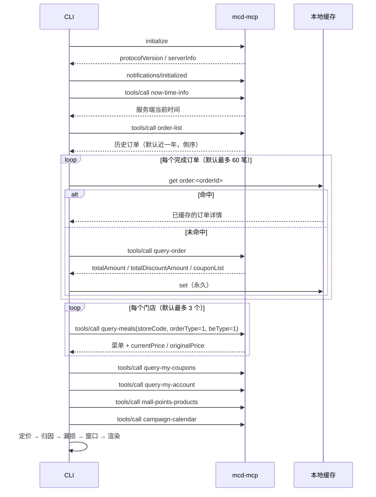

# MCP 集成说明

本文说明 `mcd-ledger` 实际使用了哪些麦当劳 MCP 工具、如何编排、每个字段用来算什么，以及在真实调用中踩到的坑与对应的降级策略。

## 1. Server 接入

| 项 | 值 |
|---|---|
| Server | 麦当劳中国 MCP Server（`mcd-mcp`） |
| 地址 | `https://mcp.mcd.cn` |
| 协议 | MCP 2025-06-18 · Streamable HTTP |
| 鉴权 | `Authorization: Bearer <MCD_MCP_TOKEN>`（Token 在 https://open.mcd.cn/mcp 申请） |
| 服务端工具数 | 实测 `tools/list` 返回 **35** 个工具 |
| 限流 | 每 Token 600 次/分钟（超限 429） |
| 客户端实现 | `src/mcp/client.ts`，零依赖，自行实现 `initialize` → `notifications/initialized` → `tools/list` → `tools/call` |

配置示例（脱敏，仅环境变量占位）见 [`mcp-config.example.json`](./mcp-config.example.json)。

## 2. 使用的工具与用途

| # | Tool | 取什么字段 | 用来算什么 | 缓存 |
|---|---|---|---|---|
| 1 | `now-time-info` | 服务端时间串 | 统一"今天"的基准，避免本机时区导致"今日到期券"判断错位 | 否 |
| 2 | `order-list` | `createTime, beType, storeCode, storeName, orderStatus, orderProductList[].{productCode, productName, quantity, comboItemList}, realTotalAmount` | 审计主体：期间、笔数、渠道、门店、时段、SKU 清单 | 否（永远是实时） |
| 3 | `query-order` | `totalAmount, realTotalAmount, totalDiscountAmount, couponList[].{couponName, discountAmount}, realDeliveryPrice, productPrice` | **归因权威源**：原价合计、实付、总优惠、逐券金额、配送费 | 永久（详情不随时间变化） |
| 4 | `query-meals` | `meals[code].{name, currentPrice, originalPrice, discountType}, categories[].name, frequent` | **增强源**：还原"单点合计"，计算套餐组合价值；门店分类用于画像 | 6 小时 |
| 5 | `query-my-coupons` | 券名、用券价、有效期窗口（日期/星期/时段）、渠道标签 | 漏损检测（即将过期、窗口错配）+ 未来 7 天购买窗口 | 否 |
| 6 | `query-my-account` | `availablePoint, accumulativePoint, usedPoint, expiredPoint, currentMouthExpirePoint, nextMouthExpirePoint` | 过期积分漏损（已发生的真实损失） | 否 |
| 7 | `mall-points-products` | 商品的积分价与现金价 | 推导"积分 → 元"兑换比，把过期积分折算成钱 | 24 小时 |
| 8 | `campaign-calendar` | 活动标题、日期、正文 | 购买窗口日历的活动维度；解释某段时间为何单价异常 | 2 小时 |

### 为什么不用其余工具

本项目**只读、不交易**，因此刻意不触碰任何写操作：`create-order`、`party-order-create`、`mall-create-order`、`draw-lottery`、`auto-bind-coupons`、`cancel-order`、`delivery-create-address`。这是产品定位（审计）也是安全边界（不会误下单、不会改动账户资产）。

## 3. 调用流程



### 实测调用量

以 9 笔订单、2 个门店的账号为例：

| 场景 | 调用次数 | 耗时 |
|---|---|---|
| 首次运行 | 17 次（1 + 1 + 9 + 2 + 4） | 3.6 s |
| 第二次运行（命中缓存） | 4 次（now-time / order-list / coupons / points） | 1.1 s |

订单详情永久缓存是关键设计：**审计的边际成本随使用次数下降**，而不是每次重算。

## 4. 字段级坑位与处理

真实调用中遇到的、文档没写清楚的地方：

### 4.1 `order-list` 返回的是"双层 data"

响应形态是 `{"data": {"data": {"list": [...]}}}`。直接读 `data.list` 会拿到 `undefined`。已在 `unwrapBusiness()` 统一拆掉。

### 4.2 `query-meals` 的菜单**随时段变化**

上午 10:05 调用只会返回早餐菜单，午餐 SKU（如中薯条、麦辣鸡腿堡）不在其中。这直接导致"用菜单反推归因"的历史订单覆盖率只有 **8%**。

→ 结论：菜单不能作为归因主源。架构因此改为以 `query-order` 为权威源（见 §5）。

### 4.3 `query-meals` 必须带 `beType`

`beType=1` 到店自取不传 `beCode`；`beType=5`（得来速）与 `beType=6`（团餐）必须带 `beCode`。本项目统一用 `beType=1 + orderType=1` 取价格字典——同一 SKU 的 `currentPrice` 与下单渠道无关。

### 4.4 `realTotalAmount` 与 `totalDiscountAmount` 的恒等式

```
totalAmount − totalDiscountAmount + 配送费 ≈ realTotalAmount
```

当 `totalDiscountAmount` 缺失时，用该式倒推；两者都存在时以平台记录为准。这条恒等式也是 `bench/cases.ts` 的断言基础。

### 4.5 券的字段没有公开说明

`query-my-coupons` 的官方描述只说明"返回用户拥有的券"，未给出字段名。本项目采用**字段嗅探**（按键名正则匹配 `couponName / price / …`）+ **有效期字符串解析**（正则匹配 `2026-10-20 05:00-2026-10-20 10:29 周二 05:00-10:29`），识别失败时返回降级信息，而不是当作"没有券"——后者会让漏损计算失真。

### 4.6 积分字段有拼写不一致

`currentMouthExpirePoint`（Mouth 而非 Month）。解析器同时兼容两种拼写。

### 4.7 菜单里存在"随单购优惠价"

`discountType = "随单购早餐卡优惠"` 且 `currentPrice` 明显低于 `originalPrice` 时，该价格**要求同时购买早餐卡**才能享受。因此本项目不用菜单价去推断"用户省了多少"，只用它算"单点合计"，避免把"需要买卡才能拿到的价"算成用户已获得的优惠。

## 5. 双源归因设计（本项目的核心）

```
权威源 query-order          增强源 query-meals
─────────────────           ─────────────────
totalAmount        ①原价    单品 currentPrice  ──► ①' 单点合计
realTotalAmount    ②实付                        （套餐拆解后相加）
totalDiscountAmount 总优惠
couponList         券明细
        │                        │
        └────────┬───────────────┘
                 ▼
      券优惠 = Σ couponList.amount
      活动优惠 = 总优惠 − 券优惠
      组合价值 = ①' − ①   （①' 取不到时为 null，不填 0）
```

**收益**：归因覆盖率从 8% 提升到 100%，且"省了多少"不再依赖任何 LLM 推断或价格猜测。

**代价**：每笔订单多一次工具调用。用永久缓存抵消。

## 6. 降级矩阵

| 失败点 | 表现 | 报告中的处理 |
|---|---|---|
| Token 无效 / 401 | CLI 直接报错并提示申请地址 | 不生成报告 |
| 429 限流 | 指数退避 + 尊重 `Retry-After`，最多 3 次 | 重试成功则无感；仍失败则该项降级 |
| `order-list` 空 | 报告为空 | 提示"先用真实账号产生 1 笔订单" |
| `query-order` 单笔失败 | 该笔 `coverage=0` | 计入实付总额，不计入节省；在 `attribution-gap` 漏损项中披露 |
| `query-meals` 失败 | `alaCarte=null` | 组合价值标「下限」，其余归因不受影响 |
| `query-my-coupons` 解析失败 | 券相关模块为空 | 降级说明写入 `quality.degradations` |
| `campaign-calendar` 失败 | 窗口日历只剩券维度 | 同上 |

所有降级都写进报告的"这份账本有多可信"区块，不隐藏。

## 7. 业务价值

对用户：

- **把"优惠"这件事讲清楚**：区分"券省的"与"套餐本来就更便宜"，让用户知道自己的省钱动作到底有没有用。
- **发现沉默损失**：过期积分、即将失效的券、有券没用——这三类损失用户通常完全无感。
- **给出下一步动作**：不是"多领券"这种空话，而是"明天 05:00–10:29 有 ¥9.9 早餐券，你上周三也在同一时段下过单"。

对麦当劳（作为参赛项目的说明，不代表官方立场）：

- 提升**券的使用率与时隙利用率**——早餐时段（05:00–10:29）是典型的低峰，本项目把券的有效窗口直接翻译成用户的下单提醒。
- 提升**积分活跃度**——积分过期是会员体系的负体验，账本把它变成"可挽回的提醒"。
- 强化**会员数据价值**——用户第一次看到自己一年在麦当劳的完整画像（时段、门店、品类、口味），这是黏性的来源。
- 全部为只读调用，不产生任何交易风险或客诉风险。

## 8. 可复现性

每次运行生成 `.trace/trace-*.jsonl`，记录每一步的工具名、耗时、成败、返回体大小与降级事件。

把该文件拖进 [`viewer/trace-viewer.html`](./viewer/trace-viewer.html) 即可看到时间线。这意味着：如果某份账本的数字有疑问，可以完整复现它的计算过程，而不是"相信一个黑箱"。
