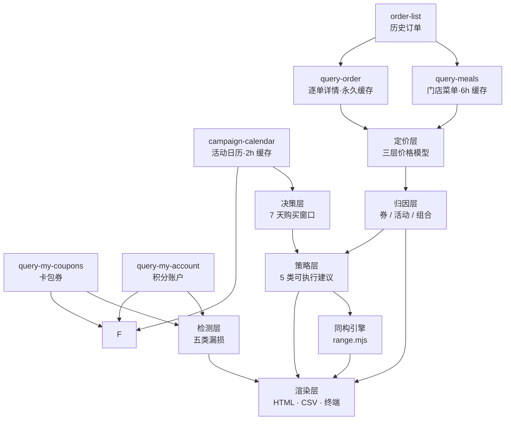

# 麦麦账本 · mcd-ledger

> 你的麦当劳消费对账单——**省了多少、漏了多少、下次什么时候买最划算**。
>
> *An auditable ledger for your McDonald's China orders. Not another "what should I eat" recommender — it does the accounting.*

[](https://nodejs.org)
[](./package.json)
[](./bench/cases.ts)
[](https://open.mcd.cn/mcp)

---

## 它解决什么问题

你每周都在点麦当劳，但你大概率答不出这三个问题：

1. **这半年我到底花了多少？** —— 外卖平台只给你一堆散落的订单，没有汇总，更没有口径。
2. **我到底省了多少？** —— 你以为用了券就省了，但"券省的钱"和"套餐本身比单点便宜的钱"是两回事，混在一起算就全是糊账。
3. **我漏掉了多少？** —— 过期作废的积分、明天 10:29 就失效的早餐券、有券却没用上的那 6 次下单。

`mcd-ledger` 用麦当劳 MCP 的 6 个只读接口把这些算清楚，输出一张**可核对**的对账单：每个数字都能点开订单对得上，算不出的地方它会留白，而不是填 0。

**它不是**：套餐推荐器、券领取脚本、饮食建议工具。**它只做一件事**：把已经花掉的钱算明白，然后告诉你下一笔怎么花更值。

---

## 30 秒上手

```bash
git clone https://github.com/<you>/mcd-ledger.git
cd mcd-ledger

# ① 先看效果（合成数据，不需要 Token）
node src/cli.ts demo

# ② 用你自己的账号审计（先申请 MCP Token：https://open.mcd.cn/mcp）
export MCD_MCP_TOKEN=<你的 token>
node src/cli.ts audit
```

不需要 `npm install`，不需要构建，**运行时零依赖**（Node ≥ 22.18 原生运行 TypeScript）。

输出三个文件：

| 文件 | 内容 |
|---|---|
| `mcd-ledger-YYYY-MM-DD.html` | 账本页：KPI、三层价格、归因、**策略建议**、漏损、购买窗口、消费画像、分享卡。**时间区间可在页面上直接切换**（近 7 / 30 / 90 天 · 全部 · 任意起止） |
| `mcd-ledger-YYYY-MM-DD.csv` | 订单级明细，可用 Excel 复算任何一个汇总数字 |
| `.trace/*.jsonl` | 每次 MCP 调用的耗时与结果，可拖进 `viewer/trace-viewer.html` 回放 |

### 在 WorkBuddy 里用

把 `mcp-config.example.json` 里的 `${MCD_MCP_TOKEN}` 换成你的 Token，配置进 WorkBuddy 的自定义连接器，然后直接说：

> 「用 mcd-ledger 帮我审计一下最近三个月的麦当劳消费」

### 作为 WorkBuddy Skill 安装

仓库内置了打包好的 Skill（`skill/mcd-ledger/`，分发件 `dist/mcd-ledger.zip`，约 150 KB，零运行时依赖）。两种用法：

```bash
# ① 解压即用：把 zip 里的 mcd-ledger/ 放进 ~/.workbuddy/skills/，重启会话后生效
unzip dist/mcd-ledger.zip -d ~/.workbuddy/skills/

# ② 从仓库源码重新打包（改了代码后）
python scripts/package_skill.py skill/mcd-ledger dist   # 或任意 skill-creator 的打包脚本
```

Skill 内部自带完整源码与两份参考（MCP 实测硬约束、报告口径解读），安装后对 WorkBuddy 说「审计我的麦当劳消费」「跑个 demo 看看」即可触发：无 Token 自动走合成数据演示，有 `MCD_MCP_TOKEN` 走真实账号审计，产物（账本页 / CSV / 方案卡 / trace）用 `present_files` 直接呈现。详见 `skill/mcd-ledger/SKILL.md`。

---

## 输出长什么样

```
  麦麦账本 · 你的麦当劳消费对账单

  期间   2026-09-21 → 2026-10-20 · 30 天 · 33 笔 · 近 30 天
  实付   ¥442.35   平均每笔 ¥13.40
  省下   ¥247.45   相当于原价 35.9%
  漏掉   ¥61.50   4 项 · 账户口径，不随区间变化
  再省   ¥129.52 / 月（估算）   4 条策略 · 1 条无法折算
──────────────────────────────────────────────────────────
  省的钱从哪来
  券优惠     ¥21.65      █░░░░░░░░░░░░░ 9%
  活动 / 卡  ¥140.90     ████████░░░░░░ 57%
  套餐组合   ¥84.90      █████░░░░░░░░░ 34%
  （另有 ¥9.00 配送费计入实付，不属优惠）
──────────────────────────────────────────────────────────
  漏掉的钱
  ¥18.60     1860.4 积分已过期作废（估算）
  ¥17.70     3 张券将在 48 小时内到期（估算）
  ¥25.20     4 张券在可用时段内被错过（估算）
  不折算     1 笔订单被取消
──────────────────────────────────────────────────────────
  下次怎么买  近 30 天
  ¥94.50/月      早餐 21 笔里有 15 笔没用券（中置信）
                下单前先翻一遍卡包：芝香脆鸡扒堡早餐两件套 05:00–10:29 正好落在你的早餐…
  ¥26.02/月      浓浓黑巧（冰/热） 等 3 个常点品有更低的买法（中置信）
                点单时先走促销 / 卡权益入口，别在默认价上下单；如果同款在套餐里，换成套…
  ¥9.00/月       1 笔外送付了 ¥9.00 配送费（高置信）
                把时间宽裕的那几单改成到店自取；必须外送时优先用「外送专用」券抵扣配送费…
  不折算         3 张券按你的节奏用不完（中置信）
                到期前优先塞进最近一次同品类订单；确实用不完的话，下次别囤同类券…
──────────────────────────────────────────────────────────
  接下来 7 天
  今天  2026-10-20  05:00–10:29  芝香脆鸡扒堡早餐两件套 ¥9.9、11.9…
  明天  2026-10-21  05:00–10:29  芝香脆鸡扒堡早餐两件套 ¥9.9、11.9…
──────────────────────────────────────────────────────────
  可归因 100% · 合成数据（未调用 MCP）
```

> 以上为 `demo` 模式的合成数据输出（价格取真实菜单，订单序列由固定种子生成）。同一日期内重复运行结果完全一致；券的有效期以运行当天为基准，但到期时间刻意跨到次日，因此「漏掉」的金额不会随打开页面的钟点漂移。

完整账本页样例见 **[docs/demo-report.html](./docs/demo-report.html)** —— 用浏览器直接打开即可，不需要跑任何命令。

---

## 数字是怎么算的：三层价格 + 双源归因

这是本项目唯一真正需要解释的部分。**一份套餐"值多少"有三个口径，混着算必然得出错误结论。**

| 口径 | 定义 | 来源 | 回答什么 |
|---|---|---|---|
| ① 单点合计 `alaCarte` | 套餐里每个子项按**单品现价**相加 | `query-meals` + 订单的 `comboItemList` | 拆开点要花多少 |
| ② 原价合计 `list` | 平台记录的 `totalAmount` | `query-order` | 平台标价多少 |
| ③ 实付 `paid` | 平台记录的 `realTotalAmount` | `query-order` | 我到底付了多少 |

于是「省下来的钱」被拆成互不重叠的三项：

```
券优惠   = Σ couponList[].discountAmount        逐券金额，可对到具体券名
活动优惠 = totalDiscountAmount − 券优惠          活动价、早餐卡、麦金卡
组合价值 = ① − ②                                 套餐比单点便宜的部分
```

**为什么要双源？** 最初只用 `query-meals` 的划线价反推，实测在真实账号上归因覆盖率只有 **8%**——因为历史订单里的季节性商品早已下架，而且菜单随时段切换（上午 10 点前只有早餐菜单）。改用 `query-order` 的 `totalAmount / totalDiscountAmount / couponList` 作为权威源后，覆盖率变成 **100%**，且每个数字都能在订单详情里对上。菜单只用来回答"组合价值"这一项额外问题。

### 算不出的时候，它说算不出

如果某笔订单的商品已下架、单品价无法还原，`组合价值` 就是 `null`，报告会把这个数字标成 **「下限」**，并单列一条 `attribution-gap` 说明。

```
省下 ¥48.00 (下限)
```

这不是缺陷，是设计：**审计报告的可信度不来自数字大，而来自每个数字都有出处、每个空白都有解释。**

---

## 它会告诉你什么：五类漏损

| 漏损 | 证据来源 | 是否折算金额 |
|---|---|---|
| 过期积分作废 | `query-my-account` 的 `expiredPoint` | ✅ 按积分兑元比折算 |
| 券即将过期 | `query-my-coupons` 的有效期窗口 | ✅ 券价 vs 菜单同款现价 |
| 券窗口错配 | 订单时间 vs 券的"日期+星期+时段" | ✅ 估算（每笔最多可省） |
| 订单被取消 | 订单状态 | ❌ 只计数，不折算 |
| 归因缺口 | 详情获取失败 | ❌ 只披露，不估算 |

「券窗口错配」是本项目最实用的一项：它找出**你在券生效的时段内下过单、但券还在卡包里**的情况——有券、有时间、有需求，三者同时成立却没被用上，这是最可惜的漏损。

---

## 时间区间筛选 + 优惠策略建议

账本页顶部有一条时间筛选：**近 7 天 / 近 30 天 / 近 90 天 / 全部 / 自定义起止日期**。切一下，概览、三层价、归因、策略、画像、分享卡会一起重算。

它不只是"看不同时间段"，而是衍生出一个新东西：**基于你选中的这段消费记录，给出针对性的优惠策略**。

### 为什么不预生成三份 HTML

预生成只能覆盖固定区间，自定义起止日期做不到；前后端各写一套聚合，用户切一次区间就会看到两套账。

所以这里是一份**同构引擎**（`src/engine/range.mjs`，纯 JS、零依赖）：

```
Node 侧：解析区间 → 首屏 SSR          ┐
                                      ├─ 同一份源码，逐字节相同
浏览器：切区间时再算一遍              ┘
```

页面里内联的是同一份文件（去掉行首 `export` + IIFE 包一层），因此**不存在"报告里是 A、页面上是 B"的可能**。实测：首屏 DOM 的 2156 个字符，与点击当前区间重算后的 DOM 完全一致。

### 策略是怎么生成的

五类检测器，每条都必须能指回具体订单：

| 策略 | 触发条件 | 金额口径 |
|---|---|---|
| **时段 × 券** | 你的高频时段与卡包券的生效时段重合，但这些订单没用券 | 单张券可省 × 未用券订单数（月化，前提写明"同类券可重复领取"） |
| **单价** | 某个常点 SKU 的实付单价高于菜单现价 | 差价 × 份数（按行分摊实付，属估算） |
| **渠道** | 有外送单产生了配送费 | 配送费本身（硬数据，高置信） |
| **券库存** | 7 天内到期的券，按你的下单频率用不完 | 不折算（面值已在漏损里记账，不重复计算） |
| **择时** | 未来 7 天的活动命中你的高频时段/常点品 | 不折算（活动规则未知，不编数） |

**区间是策略的前提，不是装饰。** 同一账号、同一时刻，换区间结论就变：

| 区间 | 订单 | 出现的策略 |
|---|---|---|
| 近 7 天 | 7 笔 | 时段×券（4 笔里 3 笔没用券，¥75.86/月）· 券库存 · 择时 |
| 近 30 天 | 33 笔 | 时段×券（15/21 未用券，¥94.50/月）· 单价（¥26.02/月）· 渠道（¥9.00/月）· 券库存 |
| 近 90 天 | 90 笔 | 时段×券（38/51 未用券，¥79.80/月）· 渠道 · 单价 · 券库存 |

7 天视图里**没有**"渠道"和"单价"策略——不是它们不存在，而是这个窗口里没有外送单、也没有按原价买的单。给 7 天的用户推"你有 4 笔外送付了 ¥36"，就是造假。

月化值也**不是一个固定数**（7 天 ¥75.86 / 30 天 ¥129.52 / 90 天 ¥79.80）：它是"这段窗口的浪费率 × 30 天"，最近 30 天正好比较浪费，月化就高。任何把月化做成常数的产品，都在骗用户。

> 完整设计（区间模型、所需字段、五类检测器的伪代码、筛选与策略的三层联动、边界与假设）见 **[STRATEGY.md](./STRATEGY.md)**。

### 什么不随区间变

过期积分、券到期、取消单是**账户级事实**，用"最近 7 天"去截断它们只会得到一个假的 0；未来 7 天的券窗口也与历史区间无关。这三节在标题右侧明写了「账户口径 · 全程」「未来 · 与区间无关」。

**筛选器不应该悄悄改变那些它管不着的东西。**

---

## 从"看账本"到"直接下单"（V2 设计）

账本回答"我过去花得对不对"，V2 回答"现在该怎么点"。两个核心页面：

| 页面 | 定位 | 被哪条实测约束决定 |
|---|---|---|
| **方案卡** | 把"中午吃什么"变成"这套 ¥31.90，要吗" | 菜单价 ≠ 结算价 —— 卡上每个数字都必须来自一次 `calculate-price` |
| **待支付确认页** | 把"要"变成一张可支付的订单，并且随时能撤回 | 待支付单 **15 分钟**过期；支付凭证是 **H5 链接**不是二维码；未支付时取餐码为空 |

- 完整设计说明（信息结构、9 个状态、跳转矩阵、异常场景矩阵、适配要求、验收清单）：**[docs/DESIGN-L2.md](./docs/DESIGN-L2.md)**
- 可点击原型（9 态 × 双主题，双击即开，无需服务端）：**[docs/prototype-v2.html](./docs/prototype-v2.html)**
- 产品设想与授权阶梯（L0 展示 → L4 代付）：**[docs/PRODUCT-V2.md](./docs/PRODUCT-V2.md)**

**原型不是静态稿，是产物。** `node src/cli.ts demo` 会用与账本页**同一份事实表 + 同一份引擎**（`src/engine/range.mjs` 的 `buildPlan`）生成它：

- 常点商品 = 区间内出现次数最多的 SKU（切 7/30/90 天会换一批，价格跟着重算）；
- 买法 = 引擎现场求解：单点现价 / 合单用券 / 拆单 / 同类更便宜 / 买卡回本线，全部可追溯到菜单现价、券 worth 与历史频次；
- 账本页的每条策略都带「按这个方案点 →」，跳转时把**区间 + 策略类型**传给原型，对面用 `planFocus` 直接选中对应买法，并用引擎按该区间重算策略横幅；
- 价格口径：菜单现价/划线价，原型不联网、不调用 `calculate-price`——真实下单前必须重新结算（S4 降级态演示的就是这件事）。

---

## 与"又一个麦当劳助手"的区别

| | 常见做法 | 本项目 |
|---|---|---|
| 时间方向 | 预测你**想吃什么**（未来） | 审计你**花了多少**（过去） |
| 数据依据 | LLM 口味推理 | 平台订单记录，可逐笔核对 |
| 算不出时 | 编一个看起来合理的数 | 标 `null` 并解释原因 |
| 输出去向 | 聊天窗口（看完即忘） | 可截图、可导出、可对账的文件 |
| 对品牌 | 常滑向"揭发商家" | 只做"让用户花得明白"的中性记账 |

---

## 架构



```
src/
├── mcp/          Streamable HTTP 客户端（零依赖）+ 本地缓存
├── runtime/      契约校验 · 重试退避 · 限流 · trace 记录
├── ingest/       六个工具的解析器（字段可缺失、可包一层 data.data）
├── model/        三层价格模型 · 文本归一化
├── audit/        归因 · 漏损检测 · 购买窗口 · 报告组装 · 事实表下发
├── engine/       同构引擎：区间筛选 · 聚合 · 策略 · 片段渲染（Node 与浏览器同一份）
├── render/       HTML 账本页 · CSV · 终端摘要
├── demo/         合成数据（无 Token 也能跑通）
└── cli.ts        命令行入口
bench/            14 条归因算法回归用例
viewer/           trace 回放器（单文件 HTML）
```

### 工程上做了什么（不是"调个接口"）

- **契约校验**：每个字段都过一层 `ContractError`，缺字段报错时带 JSON 路径，绝不让 `undefined` 流进金额计算。
- **双源降级**：订单详情拿不到 → 该笔只计入实付、不参与节省统计，并在报告里标出来。
- **永久缓存**：订单详情一旦生成不会变，按 `orderId` 永久缓存；第二次运行 MCP 调用从 17 次降到 4 次。
- **限流与退避**：官方限制 600 次/分钟，客户端内置滑动窗口限流 + 指数退避 + 尊重 `Retry-After`。
- **全链路 trace**：每次调用写 `jsonl`，可回放——线上算错了，能复现。
- **23 条回归用例**：`node src/cli.ts bench`，覆盖三层价格、双源归因、降级路径、券窗口解析、区间边界、策略触发。
- **同构引擎**：区间筛选与策略计算只有一份实现，Node 与浏览器共用，杜绝"两份算法两套账"。

---

## 隐私

- **本地运行，无服务端**。项目没有任何网络出口，除了 `mcp.mcd.cn`。
- **不写任何遥测**。
- 缓存与 trace 只存在本地 `.cache/`、`.trace/`（已在 `.gitignore` 中）。
- 账本页只输出聚合结果，**不包含订单号、门店地址、手机号**；CSV 里的订单号是用户自己的数据，供本人核对。

---

## 命令

```bash
node src/cli.ts demo                     # 合成数据演示，无需 Token
node src/cli.ts audit                    # 真实账号审计
node src/cli.ts audit --days 90          # 只拉取最近 90 天订单（省调用）
node src/cli.ts audit --range 7d         # 页面默认落在「近 7 天」（7d/30d/90d/all）
node src/cli.ts audit --range 2026-09-01..2026-10-01   # 自定义默认区间
node src/cli.ts audit --max-stores 1     # 只查 1 个门店的菜单（省调用）
node src/cli.ts audit --json             # 输出 JSON，便于二次处理
node src/cli.ts doctor                   # 检查连接与工具可用性
node src/cli.ts bench                    # 跑回归用例
```

环境变量：`MCD_MCP_TOKEN`（必需）、`MCD_MCP_URL`（可选）、`NO_COLOR`（可选）。

---

## 已知边界

1. **组合价值依赖当前菜单**：商品下架后无法还原当时的单品价，此时"省下的钱"是下限。
2. **券的字段未公开**：`query-my-coupons` 没有公开字段说明，本项目用"字段嗅探 + 有效期字符串解析"兼容，识别失败会降级而不是假装没券。
3. **积分兑元比是估算**：优先从积分商城商品反推，样本不足时按 100 积分 ≈ 1 元，报告里标「估算」。
4. **策略的月化是线性外推**：按所选区间的浪费率折算一个月，不预测你下个月的行为；不同区间会算出不同的月化值，这是预期行为。
5. **多品订单的单价是估算**：平台只给订单级实付，按行售价比例分摊到 SKU。
6. **策略之间可能重叠**（既没用券、单价也偏高），合计是上限而不是可叠加收益。
7. **只读**：本项目不下单、不领券、不改任何账户状态。

---

## 关于本项目

非官方作品，由开发者独立完成，与麦当劳无隶属关系，不代表麦当劳官方立场。输出仅供参考，不构成财务、税务或投资建议；餐品价格与供应状态以麦当劳官方渠道实时结果为准。

本项目参加**麦当劳程序员创意开发大赛**，基于麦当劳中国 MCP Server（`https://mcp.mcd.cn`）开发。参赛声明见 [CONTEST_DECLARATION.md](./CONTEST_DECLARATION.md)，MCP 集成细节见 [MCP_INTEGRATION.md](./MCP_INTEGRATION.md)。

MIT License.
