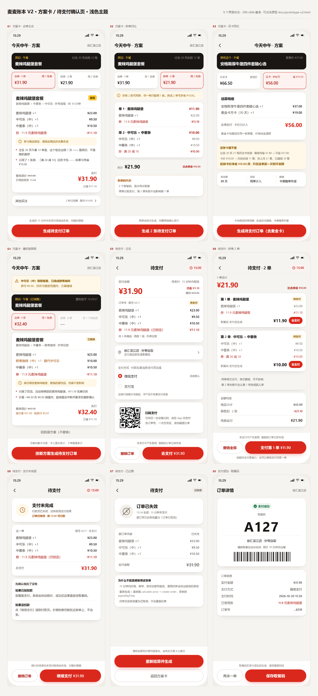

# 方案卡 · 待支付确认页 · 设计方案（v1 · 可开发）

> 交付物：本文档 + `docs/prototype-v2.html`（可点击原型）+ `docs/tokens.css`（design tokens）
> 静态评审图：`docs/shots/sheet-light.png` / `docs/shots/sheet-dark.png`（9 态拼版）
> 状态：可用于开发评审。文中所有数字（价格、约束、接口字段）来自真实账号与门店 `1420670` 的实测，不是推算。
> 更新：2026-10-20



---

## 0. 怎么评审（3 分钟）

1. 双击 `docs/prototype-v2.html`（无需服务端，`file://` 直接可跑）。
2. 右侧面板「直达界面」逐个点 S1 → S8，共 9 个界面状态。
3. 走一遍主链路：**S1 点「生成待支付订单」→ S5 点「去支付」→ 确认支付 → S8 取餐码**。
4. 走两条异常：①「场景模拟」切到**提交时售罄**，再点生成 → 落到 S4；②切到**支付中途退出**，走支付 → 落到 S9。
5. 右上角切「深色」，重复第 2 步。

左下角「事件日志」会记录每一次接口调用与状态变化，可直接对照本文档第 5、6 节。

---

## 1. 两个页面各自解决什么（以及不做什么）

| | 方案卡（S1–S4） | 待支付确认页（S5–S9） |
|---|---|---|
| 一句话定位 | **把「我中午吃什么」变成「这套，¥31.90，要吗」** | **把「要」变成一张可支付的订单，并且随时能撤回** |
| 用户此刻的心理 | 还没决定，需要被说服：为什么是这套、省了多少、有没有更好的 | 已经决定了，只关心三件事：付多少、付给谁、付错了怎么办 |
| 承载的动作 | 选方案 / 比方案 / 换方案 / 发起下单 | 核金额 / 选支付方式 / 付款 / 撤销 / 重付 |
| **不做** | 不做商品浏览、不做菜单搜索、不做购物车（现有 API 没有购物车概念） | 不做商品编辑（要改就回方案卡，保证「价格锁定」这句话不撒谎） |
| 成功的判据 | 用户点了主 CTA，且**没有**回头改方案 | 付款成功；或者撤销成功且**不产生任何费用** |

一句话记法：**方案卡负责说服，确认页负责兜底。**

### 一个刻意的取舍

方案卡上所有价格都是**结算价**，不是菜单价。原因是实测发现二者会差到近一倍：安格斯四件套菜单显示 ¥37.00，直接结算 ¥66.50（¥37 是「随单购麦金卡」价，要先买 ¥19 的卡）。

所以方案卡不提供「猜价」能力 —— 卡片上出现的每个数字都必须来自一次 `calculate-price`。这条约束决定了整个信息结构：**方案 = 一个不可变对象（商品 + 券 + 门店 + 取餐方式），渲染它的和提交它的必须是同一份数据。**

---

## 2. 六条硬约束 → 直接长成了界面

| # | 实测约束 | 界面后果 |
|---|---|---|
| 1 | 一单只能用一张券，两张同单报 `600022` | 出现「合单 1 单 / 拆单 2 单」这组**并列对比**，而不是「多选券」。拆单是唯一的多券路径 |
| 2 | 菜单价 ≠ 结算价 | 价格区永远显示 `整单原价 / 实付` 两栏；不出现「菜单价」字样 |
| 3 | `create-order` 直接产出**待支付单 + 支付链接**，没有购物车中间态 | 按钮文案必须是「**生成待支付订单**」，不能写「加入购物车」 |
| 4 | 待支付单 **15 分钟**过期（`expirePayTime`） | 确认页常驻倒计时；过期态（S7）必须提供「重新结算」而不是「重试支付」 |
| 5 | 支付凭证是 **H5 链接**（`payH5Url`），不是二维码图片 | 二维码由前端把 URL 编码成 QR 自行绘制；并标注「含订单号，请勿截图」 |
| 6 | 未支付时 `pickupCode` 是空串 | 拆单页不能提前展示取餐码，只能写「支付后生成」；S8 才出现两个码 |

> 补充一条坑：`status` 数字编码与官方文档不符（实测 **10 = 待支付，60 = 已取消**）。**状态判断一律用 `orderStatus` 文本**，否则会写出永不命中的轮询。

---

## 3. 页面一：方案卡

### 3.1 信息结构（自上而下 = 决策顺序）

| # | 区块 | 回答的问题 | 关键字段 | 数据来源 |
|---|---|---|---|---|
| 1 | 导航行 | 我在哪、给谁点 | 标题「今天中午 · 方案」、门店名 | 上下文 |
| 2 | **意图条**（深色块） | 你为什么给我看这个 | 意图标签（照旧 / 想吃这个）、证据（「过去 30 天此段 12 笔」）、方案名 | 账本聚合 |
| 3 | **方案组切换** | 我是不是买贵了 | 合单 1 单 ¥31.90（用 1 张券）/ 拆单 2 单 ¥21.90（用 2 张券） | 两套 `calculate-price` |
| 4 | **主方案卡** | 这套到底是什么 | 方案名、取餐方式与时长、逐项明细（单价）、券抵扣行、使用提示 | `query-meals` + `calculate-price` |
| 5 | **方案要点** | 凭什么信你 | 2 条：证据（12 单里出现 7 次）、机会（还有 1 张券没用上，拆单可再省 ¥10.00） | 账本 + 券包 |
| 6 | **价格区** | 付多少 | 整单原价（划线）、实付（大号）、价格锁定时间、已省 | `calculate-price` |
| 7 | 其他买法（默认折叠） | 有没有别的 | 3 种已结算方案的汇总行，展开后逐行切换 | 方案枚举 |
| 8 | **底部操作区**（不滚动） | 下一步 | 一句风险提示 + 主 CTA | — |

**为什么意图条是深色块、放最上**：它是这一页唯一回答「为什么是我」的地方。用户对推荐的第一反应是怀疑，先给证据（「此段 12 笔」）再给方案，比先给方案再解释更省一次心智往返。

**为什么「方案要点」只有 2 条、且不复述价格**：价格在上一块已经说完了。要点只承担两件价格说不清的事 —— **这推荐有没有依据**、**我是不是漏了什么**。第 2 条永远指向「拆单」，这是把下一屏的价值提前露出。

### 3.2 组件规格

| 组件 | 规格 |
|---|---|
| 意图条 | 深色底（`--intent-bg`），圆角 20，标题 13/700，方案名 17/650；右侧副信息 10.5/`--intent-sub` |
| 方案组卡 | 两列等宽，高 78；选中态：品牌红描边 + 淡红底 + 价格红；未选中：白底 + 灰价格；**不可用态**：置灰 + 价格显示「—」 |
| 明细行 | 名称 12.5/`--text`，价格 12.5 右对齐；替代项加 `swapped` 标记（名称后缀「· 替代中可乐」） |
| 券抵扣行 | 整行品牌红，后缀「（已锁定）」表示券已随单锁定 |
| 提示条 | 淡黄底 `--warn-bg`，10.5 字，前置 info 图标；只放一句「用错了会怎样」 |
| 价格区 | 左：原价划线 + 锁定时间；右：实付 26/700 + 「已省 ¥11.10」 |
| 底部操作区 | 高 101（提示 16 + 按钮 50 + 内边距）；主按钮 50 高、胶囊、品牌红填充 |

### 3.3 四个状态

| 状态 | 触发 | 差异点 |
|---|---|---|
| **S1 合单主态** | 默认 | 完整信息，其他买法折叠 |
| **S2 拆单对比** | 点「拆单 2 单」 | 方案组切换卡变主视觉；两张子单并列（各自的券与总价）；**代价块**明写「2 个取餐码，需分两次取餐」 |
| **S4 重校验降级** | 点生成时重校验返回 `60006` | 顶部黄条说明「中可乐刚刚售罄，已换成鲜煮咖啡」；方案名挂「已替换」；价格区多一行「原方案 ¥31.90 · 现多付 ¥0.50」；**其他买法整块隐藏**，只留「回到原方案（不替换）」 |
| **S3 买卡双栏** | 点「其他买法 → 买麦金卡」 | 顶部双栏：不买卡 ¥66.50 / 买卡 ¥56.00；结算明细里卡费单列一行；一块「这张卡值不值」给回本线 |

**S4 的设计原则**：价格变了，用户的第一反应是「你是不是在坑我」。所以这一屏只保留一条主线 —— 解释变化、给出新价、让你一次点掉。其他买法、次级入口全部收起，避免用户在「变了」的状态下被引导去做第三个决定。

**S3 的诚实要求**（对应产品决策 4）：必须同时出现「不买卡 ¥66.50」和「买卡 ¥56.00」，且给出回本线。文案只写「这张卡值不值」，不写「开通更省钱」；不做默认勾选、不做倒计时催促。本单口径与月度口径分开写，避免用「月省 ¥37.80」掩盖「这一单只省 ¥10.50」。

---

## 4. 页面二：待支付确认页

### 4.1 信息结构

| # | 区块 | 回答的问题 | 关键字段 |
|---|---|---|---|
| 1 | 导航行 | 还有多久 | 「待支付」+ **倒计时 chip**（≤120s 转警示色） |
| 2 | **金额区** | 付多少 | 实付金额（32/700 品牌红）、已省、原价划线、订单号尾号、状态徽标 |
| 3 | **订单明细** | 买的是什么 | 逐项商品与单价、券抵扣行（标注「已锁定」）、「共 N 件 · 用券 1 张 · 外带自取」 |
| 4 | 门店行 | 去哪儿拿 | 门店名 + 取餐方式 + 「支付成功后生成取餐码」 |
| 5 | 支付方式 | 怎么付 | 微信支付 / 支付宝，旁注「付款在麦当劳支付页完成」 |
| 6 | 扫码支付 | 换台设备付 | QR（由 `payH5Url` 生成）+ 「含订单号，一次性凭证，请勿截图分享」 |
| 7 | **底部操作区** | 反悔与前进 | 撤销（左，次要）· 去支付 ¥31.90（右，主）；上方一句「未支付不产生费用」 |

**为什么撤销必须常驻、且不能藏进二级菜单**：L2 授权的前提是「用户随时能撤回」。撤销按钮一旦需要展开菜单才能找到，用户对「一键下单」的信任就不成立。视觉上它被刻意压成**中性描边 + 红字**（`--border-strong` + `--danger-ink`），保证可见但不与主 CTA 争红色 —— 两个红色按钮并排会让主次失效。

**为什么金额区把「已省」放右上、原价放右下**：用户的阅读顺序是「总价 → 省了多少 → 原来多少」。三者同区域，避免为了看省了多少再滚一屏。

### 4.2 五个状态

| 状态 | 触发 | 差异点 |
|---|---|---|
| **S5 主态** | 生成 1 张单 | 单笔金额 + 完整明细 + 门店 + 支付方式 + QR + 双按钮 |
| **S6 拆单 2 单** | 生成 2 张单 | 顶部「2 单合计 ¥21.90 · 比合单省 ¥10.00」；两张订单卡各自带状态徽标与「去支付」；底部主 CTA 变为「支付第 1 单 ¥11.90」，付完自动切第 2 单；底部「撤销全部」；金额构成块（商品小计 / 券抵扣 2 张 / 两单实付） |
| **S7 已过期** | 倒计时归零 | 状态徽标变「已失效」；原订单内容置灰；一块「为什么不能直接复用这张单」；主 CTA 改为「**重新结算并生成**」（不是「重试支付」） |
| **S9 支付未完成** | 用户在付款页中断 / 回调没回来 | 订单**仍然有效**，倒计时继续；核心是「先确认钱扣了没有」两分支：已扣款 → 别重复付，等自动核销；未扣款 → 继续支付。底部「撤销订单 / 继续支付」 |
| **S8 支付成功** | 支付回调成功 | 取餐码（54/700）+ 条形码 + 门店 + 订单信息（实付 / 方式 / 时间 / 券 / 订单号）；拆单时并列两个码 |

**S7 的措辞原则**：过期单不能让用户以为是「支付失败」。文案写「15 分钟未支付，原订单已由系统置为『订单已取消』」，并解释**为什么不能复用**（价格、库存、券状态都可能变）。给的动作是「重新结算」，因为复用旧单会给出错误的承诺。

**S9 是这次补上的状态**。原本只设计了「成功 / 过期」，漏掉了最高频的真实情况：用户在付款页按了返回。这一屏如果缺失，用户会以为订单没了（重复下单），或者以为付过了（不取餐）。文案必须把两个分支都写死，并明确「订单仍有效 · 剩 15:00 可付款」。

---

## 5. 跳转关系与状态机

```
                    ┌──────────────── 返回 ────────────────┐
                    ▼                                      │
  ┌─────────────── S1 方案卡 · 合单 ────────────────┐       │
  │  意图条 / 合单·拆单 / 主方案 / 要点 / 价格       │       │
  └───┬───────────────┬────────────────┬───────────┘       │
      │ 切拆单         │ 展开其他买法    │ 生成待支付订单      │
      ▼               ▼                │                  │
  S2 拆单对比      S3 买卡双栏 ─────────┘                  │
      │ 生成 2 张     │ 生成（含麦金卡）                    │
      │               └──────────────┐                    │
      ▼                              ▼                    │
  ┌──────── S6 待支付 · 2 单       S5 待支付 · 1 单 ───────┤
  │  逐单支付 → 全付完 → S8        │ 撤销 → S1（带提示条）  │
  │                                │ 支付 → S8            │
  │                                │ 回调不来 → S9        │
  └────────────────────────────────┼──────────────────────┘
                                   ▼
                              S9 支付未完成 ──继续支付──► 回 S5 支付弹层
                                   │ 撤销 → S1
                                   │ 倒计时归零 → S7
                                   ▼
                              S7 已过期 ──重新结算──► S5（新单、新倒计时）
  S4 降级：S1 生成时重校验失败 → 原地替换方案（不回退、不跳页）
  S8 支付成功 ──再来一单──► S1
```

### 跳转矩阵

| 从 | 动作 | 到 | 副作用 |
|---|---|---|---|
| S1 | 点「拆单 2 单」 | S2 | 无接口调用，纯本地切换（两套价都已算好） |
| S1/S2 | 点「生成待支付订单」 | S5 / S6 | `calculate-price` 重校验 → `create-order`；启动 15:00 倒计时 |
| S1 | 生成时重校验命中售罄 | S4（原地） | 同一屏内替换方案，价差 ≤ 阈值则继续，超阈值中断并要求重新确认 |
| S1 | 其他买法 → 买麦金卡 | S3 | 打开双栏对比页 |
| S3 | 生成 | S5 | 卡费与商品同单，`withOrder` 已生效 |
| S5 | 去支付 → 确认支付 | S8 | 唤起 `payH5Url`，等待回调；成功后取餐码落位 |
| S5 | 撤销 → 二次确认 | S1 | `cancel-order(reasonCode=3)`；回 S1 并显示「已撤销 · 未产生费用」提示条 |
| S5 | 回调未返回 | S9 | 订单不变，倒计时继续 |
| S9 | 继续支付 | 支付弹层（停留 S9） | 重新唤起付款页 |
| S9 / S5 | 倒计时归零 | S7 | 订单置为已取消；不产生费用 |
| S7 | 重新结算并生成 | S5 | **重新** `calculate-price` + `create-order`，拿新的 `expirePayTime` |
| S6 | 支付第 1 单 | S6（局部更新） | 第 1 单转「已支付」并出码；主 CTA 自动切到第 2 单 |
| S8 | 再来一单 | S1 | 清空订单与倒计时 |

---

## 6. 异常场景矩阵

| 场景 | 触发条件 | 界面表现 | 可执行动作 | 绝不能做 |
|---|---|---|---|---|
| 提交时售罄 | `calculate-price` 返回 `60006` | S4 黄条 + 「已替换」徽标 + 价差行 | 按新方案生成 / 回到原方案 | 不提示就换商品；或静默改价后仍显示旧价 |
| 价差超阈值 | 重校验后价差 > ¥0.50 | 中断生成，要求重新确认 | 回方案卡确认新价 | 自动按新价下单 |
| 券已失效 | 券在下单前被用掉/过期 | 券行变灰并标注「已失效」，实付上调 | 移除该券重算 | 仍显示旧优惠 |
| 待支付过期 | 倒计时归零 | S7：状态「已失效」、内容置灰 | 重新结算并生成 | 复用旧单/旧支付链接 |
| 支付中途退出 | 回调未返回 | S9：订单仍有效 + 两分支说明 | 继续支付 / 撤销 | 直接判失败；或重复发起新单 |
| 已扣款未回调 | 同上 | S9「如果已经扣款」分支 | 等待自动核销 | 引导重复支付 |
| 主动撤销 | 用户点撤销 | 二次确认弹层 → 回 S1 + 提示条 | 确认撤销 / 再想想 | 无二次确认；撤销后仍显示倒计时 |
| 多单部分支付 | 拆单场景第 2 单失败 | S6 中第 1 单「已支付」+ 第 2 单「待支付」 | 单独重付第 2 单 / 撤销第 2 单 | 把第 1 单一起回滚 |
| 接口超时 / 网络失败 | 请求无响应 | 按钮 loading → 失败 toast + 原地重试 | 重试 | 空白页；或显示「已下单」但无订单号 |

**文案规范（写死在代码里，避免开发自由发挥）**

- 不用「加入购物车 / 购物车」——产品里没有购物车，写出来就是撒谎。
- 不用「支付成功」以外的乐观措辞；回调未到一律「支付未完成」，不写「支付失败」。
- 金额永远带符号与两位小数（`¥31.90`），不写「31.9 元」。
- 不出现接口错误码（`60006` / `600022`）给终端用户，错误码只进日志与埋点。
- 「省」只用于**已经发生**的优惠；**将要**发生的用「可再省」。

---

## 7. 适配要求

| 维度 | 要求 |
|---|---|
| 基准尺寸 | 390 × 844（iPhone 14/15）；验收另测 375 与 430 |
| 最小宽度 | 320 不断行错乱；`device` 宽度 `min(390px, 100vw - 24px)` |
| 安全区 | 底部操作区 `padding-bottom: max(16px, env(safe-area-inset-bottom))`；toast/弹层同理 |
| 滚动 | 正文独立滚动（`.scr-body`），导航行与底部操作区**不参与滚动**；正文顶部留白 `--gutter-top(12) ≥ --fade-nav(9)`，防止导航渐隐压住首卡 |
| 深色主题 | 与 `demo-report.html` 同源（底 `#09090A`）；卡片抬到 `#17171B`，边框用白色透明度而非灰实色；切换不闪白（`color-scheme` 同步） |
| 字号下限 | 辅助文字 ≥ 10.5px，行高 ≥ 1.5；正文 ≥ 12.5px；金额主数字 26–32px |
| 触控 | 可点区域 ≥ 44 × 44；主按钮高 50；两按钮间距 ≥ 12 |
| 无障碍 | 状态变化用 `aria-live="polite"`；弹层 `role="dialog" aria-modal`；`<button>` 而非 div；焦点可见（`:focus-visible` 2px 品牌红） |
| 对比度 | 全部文字 ≥ WCAG AA（4.5:1），小字禁用仅靠灰度分级 —— 层级由字号承担 |
| 动效 | 120/220/320ms 三档，缓动 `cubic-bezier(.22,.61,.36,1)`；`prefers-reduced-motion` 全部归零 |
| 二维码 | 由 `payH5Url` 前端编码；QR 容器必须是**浅底深码**，深色主题下也不反色 |
| 数字 | 一律等宽数字（`font-variant-numeric: tabular-nums`），倒计时跳动不抖宽 |

---

## 8. Design tokens（摘要）

完整定义见 `docs/tokens.css`（浅/深两套 + 圆角/阴影/间距/字号/动效/布局变量）。关键项：

| 用途 | 浅色 | 深色 | 说明 |
|---|---|---|---|
| 页面底 | `#f6f4f1` | `#09090a` | 深色与 demo 同底 |
| 卡片面 | `#ffffff` | `#17171b` | 深色卡片比底色亮 14 级，边界可读 |
| 卡内次级块 | `#f7f5f2` | `#202026` | 合计条、提示条 |
| 主文字 | `#1a1614` (16.4:1) | `#f3efe6` (17.3:1) | |
| 辅助文字 | `#635d57` (5.9:1) | `#a29c90` (7.3:1) | 原设计稿 3.3:1，已压深 |
| 脚注下限 | `#736c66` (4.7:1) | `#8f897e` (5.7:1) | 不得再浅 |
| 品牌红（填充/大号） | `#da291c` | `#e23b2e` | 只用于 ≥18px 或填充块 |
| 品牌红（小字） | `#b0231a` (6.8:1) | `#f4685b` (6.6:1) | 券抵扣金额、链接 |
| 警示 | `#a85610` / `#fff8e8` | `#e0a24e` / 10% 金 | 售罄条、降级徽标 |
| 撤销 | `#b0231a` 字 + `#dcd6ce` 边 | `#f4685b` 字 + 26% 白边 | 刻意不与主 CTA 同红 |

---

## 9. 界面字段 ← MCP 接口映射

| 界面字段 | 来源工具 | 字段 / 说明 |
|---|---|---|
| 商品名、单价、可单点 | `query-meals` | `productCode` / `name` / `currentPrice`（注意：可能是「随单购卡优惠价」，仅作展示，不作为结算依据） |
| 券名、面值、适用商品 | `query-store-coupons` | `couponId` / `couponCode` / 绑定 `productCode` / `tradeDateTime`（**只有这个接口给 couponId**） |
| 整单原价 / 券抵扣 / 实付 | `calculate-price` | 逐行 `sale` 与 `quantity` 反算单价；`takeWayList` 取取餐方式 |
| 卡费行（¥19.00） | `calculate-price` + `withOrder` | 传 `membershipCode:106, membershipSpecId:870` 后卡费显式出现在商品列表 |
| 订单号 / 尾号 | `create-order` | `orderId`（前端只展示后 4 位，完整号不进 UI、不进分享卡） |
| 支付二维码 | `create-order` | `payH5Url = https://m.mcd.cn/mcp/scanToPay?orderId=…`，由前端编码成 QR |
| 倒计时 | `create-order` | `expirePayTime = 下单时间 + 15min` |
| 取餐码 | `query-order` / 支付回调 | `pickupCode`，**支付成功前为空串** |
| 订单状态 | `query-order` | 用 `orderStatus` **文本**（「待支付」/「订单已取消」），不用 `status` 数字 |
| 撤销结果 | `cancel-order` | `cancelReasonCode=3` → `cancelResult: true` |
| 意图证据（12 单 / 7 次） | 账本 | 本地聚合，不走接口 |

---

## 10. 验收清单（已实测）

自动化：`out/verify-l2.mjs`（几何 + 要素 + 交互回归）、`out/audit-contrast.mjs`（对比度）。

| # | 项目 | 结果 |
|---|---|---|
| 1 | 9 个界面状态均可直达，无报错 | ✅ 0 exception |
| 2 | 双主题下每屏首屏无内容被底部操作区遮挡 | ✅ S1/S2/S3/S5/S6/S7/S9/S8 溢出 0；S4 溢出 7px（仅「回到原方案」需轻扫） |
| 3 | 方案卡要素齐全（套餐名 / 要点 / 价格 / 可选操作） | ✅ 逐项断言通过 |
| 4 | 确认页要素齐全（订单明细 / 支付金额 / 支付方式 / 确认入口） | ✅ 逐项断言通过 |
| 5 | 主链路 S1 → S5 → S8 可点击贯通 | ✅ |
| 6 | 拆单链路 S2 → S6 → 逐单支付 → S8（2 个取餐码） | ✅ |
| 7 | 售罄降级 S1 → S4（价差 +¥0.50，方案继续） | ✅ |
| 8 | 支付未完成 S5 → S9 → 继续支付 | ✅ |
| 9 | 过期 S7 → 重新结算 → S5（新单新倒计时） | ✅ |
| 10 | 撤销 → 二次确认 → 回 S1 + 提示条 | ✅ |
| 11 | 买卡双栏切换 ¥66.50 / ¥56.00 | ✅ |
| 12 | 金额自洽（43.00 − 11.10 = 31.90；23.00+20.00−21.10 = 21.90；43.50 − 11.10 = 32.40；37.00+19.00 = 56.00） | ✅ |
| 13 | 回本线自洽（21×1.80=37.80；卡价 19 → 回本 11 笔；37.80−19=18.80） | ✅ |
| 14 | 文字对比度 9 屏 × 2 主题 + 弹层 + toast | ✅ 0 处低于 AA |
| 15 | 360px 窄屏 | ✅ 布局不炸，标题省略号 |

---

## 11. 未闭环 / 待确认

1. **支付成功后的 `status` 值未验证**（需真实付款）。影响为零：全部状态判断走 `orderStatus` 文本。
2. **`payH5Url` 在真机上的唤起方式未验证**（H5 / 唤起 App / 需要 WebView 权限）。当前设计按「H5 页面 + 可扫二维码」双路径兜底，若只能唤起 App，则 S5 的扫码卡片降级为「复制支付链接」。
3. **拆单的两单是否能合并出餐**未知。因此 S2/S6 一律明写「2 个取餐码，需分两次取餐」，不外推。
4. **券库存与门店差异**：`query-store-coupons` 按门店返回，跨店方案需重新取券，当前设计只覆盖单门店。
5. **价格锁定时间**取「下单时刻 + 15 分钟」推算，若后端另有 `expirePayTime` 以外的锁价窗口，以接口为准。
